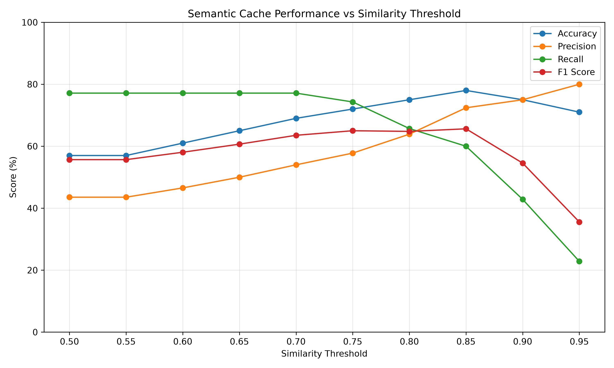
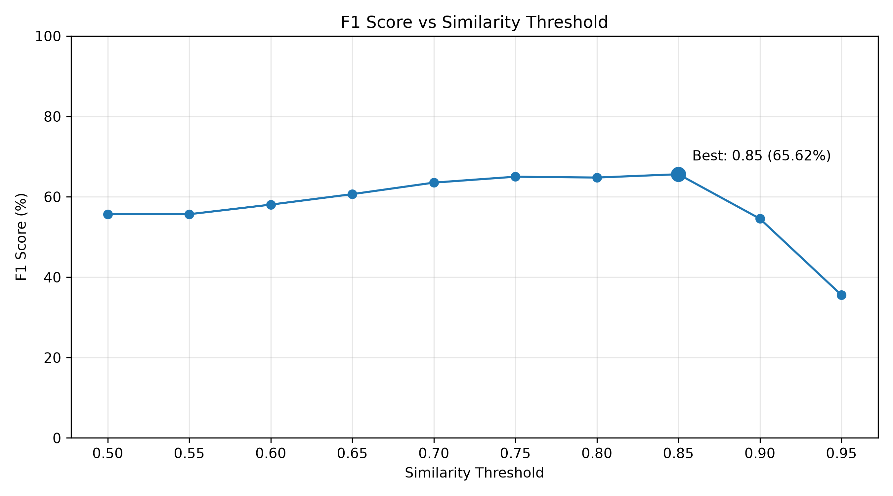
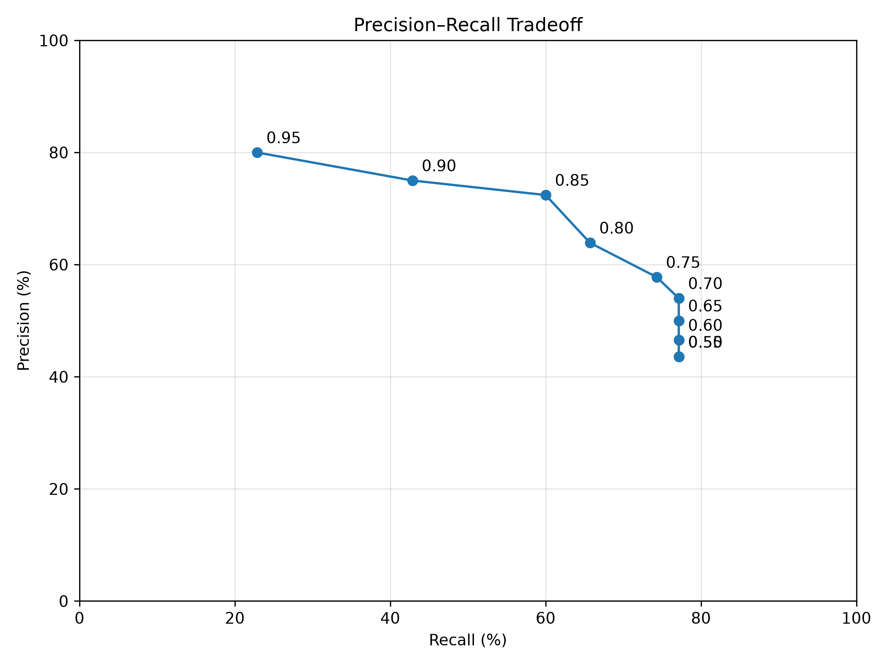
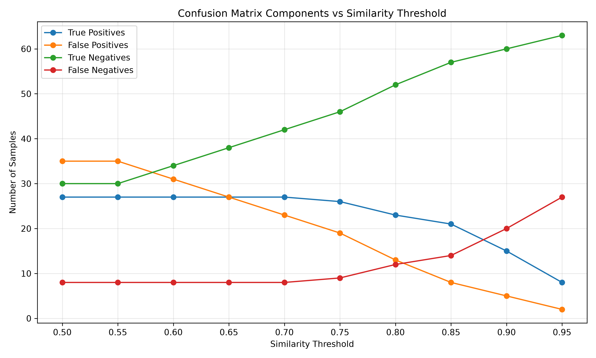

# Semantic Caching, PostgreSQL Persistence & PII Redaction Middleware

A high-performance, privacy-focused **Semantic Caching, PostgreSQL Persistence & Data Anonymization Middleware** designed for Large Language Model (LLM) applications.

This repository provides an end-to-end asynchronous pipeline that combines **Vector Similarity Search (Redis HNSW)**, **Persistent Storage & Vector Recovery (PostgreSQL with `pgvector`)**, **Unified Model Routing & Proxying (LiteLLM Gateway)**, **Privacy Protection / PII Redaction (Microsoft Presidio)**, **Local LLM & Embedding Services (Ollama)**, **JWT Authentication & Access Control**, and a **Classification & Performance Benchmarking Framework**.

---

## 📋 Table of Contents

- [Overview](#-overview)
- [System Architecture](#-system-architecture)
- [Features](#-features)
- [Repository Structure](#-repository-structure)
- [Prerequisites](#-prerequisites)
- [Quick Start & Setup](#-quick-start--setup)
- [Services & Docker Stack](#-services--docker-stack)
- [Configuration & Environment Variables](#-configuration--environment-variables)
- [API Endpoints](#-api-endpoints)
- [Custom PII Redaction Rules](#-custom-pii-redaction-rules)
- [Benchmarking & Visualizations](#-benchmarking--visualizations)
- [Testing](#-testing)
- [License](#-license)

---

## 🔍 Overview

Querying LLMs directly for recurring or semantically similar prompts introduces unnecessary latency, high compute overhead, and privacy risks when user prompts contain Sensitive / Personally Identifiable Information (PII).

This middleware solves these problems by:
1. **Redacting Sensitive PII Data** before queries reach the LLM or cache storage using Presidio Analyzer/Anonymizer microservices with runtime rule reloading.
2. **Embedding & Searching Queries** against a Redis Vector Store using cosine distance calculation (HNSW index).
3. **Serving Instant Cache Hits** when semantically similar queries are detected above a configurable similarity threshold.
4. **Persisting Cache Entries in PostgreSQL (`pgvector`)** to record hit counts, access timestamps, and recover top-K hit cache entries upon application startup.
5. **Routing & Managing Models via LiteLLM Gateway**, unifying LLM completion and embedding service interfaces.
6. **Delegating Cache Misses** to an LLM provider via LiteLLM or Ollama, then caching the resulting response for future matching.
7. **Securing Administrative Actions** via OAuth2 JWT Bearer authentication.

---

## 🏗️ System Architecture

```
                       ┌─────────────────────────┐
                       │       Client Request    │
                       └────────────┬────────────┘
                                    │
                                    ▼
                       ┌─────────────────────────┐
                       │   FastAPI Web Server    │
                       │ (JWT Auth & Lifecycle)  │
                       └────────────┬────────────┘
                                    │
                         PII Check  ▼  (Presidio Analyzer)
                       ┌─────────────────────────┐
                       │     QueryProcessor      │
                       └────────────┬────────────┘
                                    │
                ┌───────────────────┴───────────────────┐
                │                                       │
      PII Found │                                       │ Clean Query
                ▼                                       ▼
    ┌──────────────────────┐                ┌───────────────────────┐
    │  Direct LLM Request  │                │ LiteLLM Embedder      │
    │  (Cache Bypassed)    │                └───────────┬───────────┘
    └──────────────────────┘                            │
                                                        ▼
                                            ┌───────────────────────┐
                                            │ Redis HNSW Vector     │
                                            │ Search (FLOAT32)      │
                                            └───────┬───────┬───────┘
                                                    │       │
                                         Cache Hit  │       │ Cache Miss
                                                    ▼       ▼
                                            ┌──────────┐ ┌─────────────────────────┐
                                            │ Return   │ │ LiteLLM / Ollama        │
                                            │ Cached   │ │ LLM Service             │
                                            │ Response │ └────────────┬────────────┘
                                            └────┬─────┘              │
                                                 │                    ▼
                                                 │         ┌──────────────────────────┐
                                                 │         │ Store in Redis Cache &   │
                                                 │         │ Persist to PostgreSQL    │
                                                 │         └──────────────────────────┘
                                                 ▼
                                     ┌─────────────────────────┐
                                     │ Update Hit Metrics in   │
                                     │ PostgreSQL (pgvector)   │
                                     └─────────────────────────┘
```

---

## ✨ Features

- **🚀 Async Semantic Caching**: Powered by Redis Stack with HNSW vector index (`FLOAT32`, Cosine distance metric).
- **🐘 Persistent Database Layer (`pgvector`)**: Stores cache entries in PostgreSQL for durability across restarts, tracking metrics (`hit_count`, `last_hit_at`, `last_accessed_at`), and pre-warming top-K hit entries into Redis during application startup.
- **🌐 LiteLLM Gateway Routing**: Unified proxy layer for LLM inference and embeddings with configurable model definitions ([`config.yaml`](file:///home/baha/Documents/internship/config.yaml)).
- **🔒 Automated PII Redaction**: Integrates Presidio Analyzer and Anonymizer to identify sensitive entities and bypass/redact sensitive data.
- **🔄 Dynamic Presidio Rule Reloading**: Uploads custom YAML rules and hot-reloads the Presidio Analyzer service in real time without restarting containers.
- **🔐 JWT Authentication & Security**: Secures administrative API endpoints (such as cache deletion) using OAuth2 JWT Bearer tokens.
- **🦙 Ollama Integration**: Local LLM (`qwen2.5:0.5b`) and vector embedding (`qwen3-embedding:0.6b`) support.
- **📊 Cache Analytics & Management**: Endpoints for inspecting Redis memory usage, key counts, and PostgreSQL top-K entries.
- **🛠️ Integrated Developer Tools**: Includes **RedisInsight** (Redis GUI) and **PgAdmin4** (PostgreSQL GUI) in the Docker Compose stack.
- **⚡ Classification Benchmarking Suite**: Evaluates cache duplicate detection performance on datasets (e.g., Quora Question Pairs) and outputs metrics including Confusion Matrix (TP, FP, TN, FN), Accuracy, Precision, Recall, and F1 Score.
- **🧪 Comprehensive Test Coverage**: Unit tests with mock components (`FakeLLM`, `FakeEmbedder`, `FakeRedisService`) and full integration tests.

---

## 📁 Repository Structure

```
.
├── API/                          # FastAPI web application layer
│   ├── app.py                    # Main FastAPI app initialization & router composition
│   ├── lifespan.py               # Async startup/shutdown initialization & DB pre-warming
│   ├── auth/                     # JWT authentication & security utilities
│   │   └── security.py           # Password hashing, JWT token generation & verification
│   ├── routes/                   # Modular APIRouters
│   │   ├── auth.py               # Authentication endpoint (/auth/login)
│   │   ├── chat.py               # Query processing endpoints (/chat/lite_llm, /chat/fake_ask)
│   │   ├── delete.py             # Protected cache deletion routes (/delete/cache, /delete/fake_cache)
│   │   ├── redaction_rules.py    # Dynamic Presidio rules upload (/rules/upload-redaction-rules)
│   │   ├── stats.py              # Redis cache statistics route (/stats/stats)
│   │   └── top_k_entries.py      # PostgreSQL top-K entries route (/stats/postgres_entries)
│   └── schemas/                  # Pydantic request/response validation models
│       └── query_request.py      # QueryRequest & NumberOfEntries schemas
├── benchmark/                    # Load testing and performance benchmarking framework
│   ├── main.py                   # Main benchmark entrypoint script
│   ├── clients/                  # API clients (AuthClient, CacheClient)
│   ├── datasets/                 # Benchmarking datasets (train.csv)
│   ├── metrics/                  # Classification metrics (ClassificationMetrics)
│   ├── quora_questions/          # Dataloader & schemas for Quora Question Pairs
│   ├── runners/                  # Benchmark execution runners (SequentialBenchmarkRunner)
│   └── workers/                  # Worker execution engine (Worker)
├── custom_recognizers/           # Custom Presidio YAML recognizer rules directory
├── litellm/                      # LiteLLM proxy configuration directory
│   └── config.yaml               # LiteLLM model routing definitions & master settings
├── ollama/                       # Local Ollama model storage & configuration
├── postgres/                     # PostgreSQL database initialization & schemas
│   ├── init-cache-db.sh          # Database creation script for cache persistence
│   └── schema.sql                # SQL schema definition with pgvector extension
├── semantic_caching/             # Core semantic caching & privacy modules
│   ├── semantic_caching.py       # Main SemanticCaching orchestration engine
│   ├── query.py                  # QueryProcessor client for Presidio microservices
│   ├── cache_entry/              # Cache entry data structures
│   │   ├── cache_entry.py        # Base cache entry schema
│   │   ├── cache_entry_persistent.py # PostgreSQL persistent entry schema
│   │   └── cache_entry_retrieval.py  # Redis retrieval entry schema
│   ├── cache_invalidation/       # Cache invalidation strategies
│   ├── embedding_services/       # Abstract and concrete embedder classes (LiteLLM, Ollama)
│   ├── llm_services/             # Abstract and concrete LLM classes (LiteLLM, FakeLLM)
│   ├── postgres_service/         # Asyncpg PostgreSQL service layer for pgvector
│   │   └── postgres_service.py   # Connection pooling, persistence, and hit count updates
│   ├── presidio_analyzer/        # Custom Presidio Analyzer microservice container
│   │   ├── Dockerfile
│   │   ├── prisidio_reload_service.py # Dynamic rule reload client service
│   │   └── server.py             # Presidio analyzer API with dynamic YAML rule loader
│   └── vector_store_services/    # Abstract and concrete vector store classes (Redis)
│       ├── redis_service.py      # Async Redis HNSW vector store service
│       └── vector_search_result.py # Search result wrapper
├── testing/                      # Test suite
│   ├── fake_components/          # Mocks for unit testing (FakeLLM, FakeEmbedder, FakeRedis)
│   ├── unit_tests/               # Pytest unit tests for pipeline & threshold logic
│   └── integration_testing/      # End-to-end integration tests against live services
├── utils/                        # Utility helper functions
│   └── cosine_similarity.py      # NumPy cosine similarity calculation helper
├── visualizations/               # Benchmark visualization scripts & generated charts
│   ├── visualize_results.py      # Plot generation script for performance metrics
│   └── results.json              # Evaluated threshold benchmark results
├── config.py                     # Centralized settings & Pydantic env config
├── config.yaml                   # Root LiteLLM config mapping
├── Dockerfile                    # Container definition for FastAPI app
├── docker-compose.yml            # Multi-service stack composition
├── pytest.ini                    # Pytest configuration
└── requirements.txt              # Python project dependencies
```

---

## ⚙️ Prerequisites

- **Docker** & **Docker Compose** (recommended for full stack deployment)
- **Python 3.12+** (if running application modules locally)
- **Redis Stack Server** (with RediSearch enabled)
- **PostgreSQL 17** (with `pgvector` extension)
- **Ollama** running locally with models pulled (`qwen2.5:0.5b` and `qwen3-embedding:0.6b` or configured equivalents)

---

## 🚀 Quick Start & Setup

### 1. Using Docker Compose (Recommended)

Start the full containerized multi-service stack:

```bash
docker-compose up --build -d
```

The stack launches all 9 integrated services:
- **FastAPI Middleware**: `http://localhost:8000`
- **LiteLLM Gateway**: `http://localhost:4000`
- **PgAdmin (PostgreSQL GUI)**: `http://localhost:5050`
- **RedisInsight (Redis GUI)**: `http://localhost:5540`
- **Presidio Analyzer**: `http://localhost:5002`
- **Presidio Anonymizer**: `http://localhost:5001`
- **Ollama API**: `http://localhost:11434`
- **Redis Vector Database**: Port `6380` (mapped to internal `6379`)
- **PostgreSQL Database**: Port `5432`

### 2. Manual Local Setup

1. **Create and activate a virtual environment**:
   ```bash
   python -m venv .venv
   source .venv/bin/activate
   ```

2. **Install Python dependencies**:
   ```bash
   pip install -r requirements.txt
   ```

3. **Configure Environment Variables**:
   Create a `.env` file in the root directory (see [Configuration section](#-configuration--environment-variables)).

4. **Launch the FastAPI application**:
   ```bash
   uvicorn API.app:app --host 0.0.0.0 --port 8000 --reload
   ```

---

## 🐳 Services & Docker Stack

| Service Container | Internal Port | Host Port | Description |
| :--- | :--- | :--- | :--- |
| `fastapi` | `8000` | `8000` | FastAPI Web Application & Core Middleware Pipeline |
| `litellm` | `4000` | `4000` | LiteLLM Proxy Gateway for model completions and embeddings |
| `postgres` | `5432` | internal | PostgreSQL 17 with `pgvector` for cache persistence |
| `pgadmin` | `80` | `5050` | Web-based management GUI for PostgreSQL |
| `redis` | `6379` | `6380` | Redis Stack vector database with HNSW search index |
| `redisinsight` | `5540` | `5540` | Web-based GUI for Redis data inspection |
| `ollama` | `11434` | `11434` | Ollama local model inference server |
| `presidio-analyzer` | `3000` | `5002` | Custom Presidio Analyzer with dynamic rule reloading API |
| `presidio-anonymizer` | `3000` | `5001` | Presidio Anonymizer microservice |

---

## 🛠️ Configuration & Environment Variables

System settings are managed in [`config.py`](file:///home/baha/Documents/internship/config.py) and configured via environment variables or a `.env` file:

| Variable | Default Value | Description |
| :--- | :--- | :--- |
| `REDIS_HOST` | `localhost` | Hostname of the Redis server |
| `REDIS_PORT` | `6379` | Port of the Redis server |
| `OLLAMA_HOST` | `http://localhost:11434` | Endpoint URL of the Ollama service |
| `ANALYZER_URL` | `http://localhost:5002/analyze` | Presidio Analyzer endpoint |
| `ANONYMIZER_URL` | `http://localhost:5001/anonymize` | Presidio Anonymizer endpoint |
| `CUSTOM_RULES_DIR` | `./custom_recognizers` | Directory containing custom Presidio YAML rules |
| `CACHE_POSTGRES_HOST` | `postgres` | Hostname of the PostgreSQL database |
| `CACHE_POSTGRES_PORT` | `5432` | Port of the PostgreSQL database |
| `CACHE_POSTGRES_DB` | *(Required)* | Database name for cache persistence |
| `CACHE_POSTGRES_USER` | *(Required)* | Database user for cache persistence |
| `CACHE_POSTGRES_PASSWORD` | *(Required)* | Database password for cache persistence |
| `MODEL_NAME` | *(Configured)* | LiteLLM model identifier for chat completions |
| `API_KEY` | *(Configured)* | API Key for LiteLLM completion service |
| `EMBEDDING_MODEL_NAME` | *(Configured)* | LiteLLM model identifier for embeddings |
| `API_KEY_EMB` | *(Configured)* | API Key for LiteLLM embedding service |
| `EMBEDDING_MODEL_DIMENSION` | `1024` | Vector dimension size of embeddings |
| `DELETE_ON_SHUTDOWN` | `true` | Flushes Redis vector cache on FastAPI application shutdown |
| `JWT_SECRET_KEY` | *(Required)* | Secret key for signing JWT tokens |
| `ADMIN_USERNAME` | *(Required)* | Administrative username for API access |
| `ADMIN_PASSWORD_HASH` | *(Required)* | Hashed password for admin authentication |
| `ADMIN_PASSWORD` | *(Required)* | Plaintext admin password (used for login and tests) |

---

## 📡 API Endpoints

### 1. Authentication (Login)
- **URL**: `POST /auth/login`
- **Body** (`application/x-www-form-urlencoded`):
  - `username`: Admin username
  - `password`: Admin password
- **Response**:
  ```json
  {
    "access_token": "<JWT_TOKEN>",
    "token_type": "bearer"
  }
  ```

### 2. Ask Question (LiteLLM & Redis/PostgreSQL Pipeline)
- **URL**: `POST /chat/lite_llm`
- **Body**:
  ```json
  {
    "query": "What is machine learning?"
  }
  ```
- **Response (Cache Miss)**:
  ```json
  {
    "cache_hit": false,
    "cosine_distance": null,
    "answer": "Machine learning is a branch of artificial intelligence...",
    "time": "2026-08-20T16:00:00.000000"
  }
  ```
- **Response (Cache Hit)**:
  ```json
  {
    "cache_hit": true,
    "cosine_distance": 0.0342,
    "answer": "Machine learning is a branch of artificial intelligence...",
    "time": "2026-08-20T16:00:00.000000",
    "id": "lite:550e8400-e29b-41d4-a716-446655440000",
    "ttl": 86400
  }
  ```

### 3. Fast / Fake Ask (Benchmarking Endpoint)
- **URL**: `POST /chat/fake_ask`
- **Body**:
  ```json
  {
    "query": "What is Python?"
  }
  ```

### 4. Cache Statistics (Redis)
- **URL**: `GET /stats/stats`
- **Response**:
  ```json
  {
    "Total keys": 42,
    "Memory used (bytes)": 1542000
  }
  ```

### 5. PostgreSQL Top-K Cache Entries
- **URL**: `POST /stats/postgres_entries`
- **Body**:
  ```json
  {
    "k": 5
  }
  ```
- **Response**:
  ```json
  {
    "entries": [
      {
        "question": "What is machine learning?",
        "hit_count": 14,
        "embedding_dimension": 1024
      }
    ]
  }
  ```

### 6. Clear Redis Cache (Protected)
- **URL**: `DELETE /delete/cache`
- **Headers**: `Authorization: Bearer <JWT_TOKEN>`
- **Response**:
  ```json
  {
    "message": "Cache deleted successfully."
  }
  ```

### 7. Clear Fake Cache (Protected)
- **URL**: `DELETE /delete/fake_cache`
- **Headers**: `Authorization: Bearer <JWT_TOKEN>`
- **Response**:
  ```json
  {
    "message": "Fake Cache deleted successfully."
  }
  ```

### 8. Upload Custom Redaction Rules
- **URL**: `POST /rules/upload-redaction-rules`
- **Form Data**: `file` (`.yaml` / `.yml`)
- **Note**: Uploading a valid YAML rule file automatically triggers a real-time hot reload of the Presidio Analyzer recognizer registry.

---

## 🛡️ Custom PII Redaction Rules

Custom YAML rules can be placed in `custom_recognizers/` or uploaded via `/rules/upload-redaction-rules`.

Example YAML rule structure:
```yaml
recognizers:
  - name: "EmployeeIDRecognizer"
    supported_language: "en"
    supported_entity: "EMPLOYEE_ID"
    patterns:
      - name: "emp_id_pattern"
        regex: "\\bEMP-\\d{5}\\b"
        score: 0.95
```

---

## 📊 Benchmarking & Visualizations

### 🏃 Running Benchmarks

Run the classification benchmarking framework against live or mock endpoints:

```bash
python -m benchmark.main
```

The runner authenticates via JWT, iterates through question pairs from the Quora dataset (`benchmark/datasets/train.csv`), and calculates performance metrics:

```text
===== Benchmark Results =====
true_positives: 45
false_positives: 2
true_negatives: 48
false_negatives: 5
accuracy: 0.9300
precision: 0.9574
recall: 0.9000
f1_score: 0.9278
```

### 📈 Performance & Threshold Visualizations

To analyze performance metrics across similarity threshold settings, execute:

```bash
python visualizations/visualize_results.py
```

This generates visual charts saved in the project root:

#### 1. Performance Metrics vs. Similarity Threshold
Tracks **Accuracy**, **Precision**, **Recall**, and **F1 Score** across threshold values (0.50 to 0.95).



#### 2. F1 Score Optimization
Highlights the F1 Score curve across similarity thresholds to pinpoint optimal threshold balance.



#### 3. Precision–Recall Tradeoff
Shows the trade-off curve between Precision and Recall for evaluated thresholds.



#### 4. Confusion Matrix Breakdown
Displays counts of **True Positives (TP)**, **False Positives (FP)**, **True Negatives (TN)**, and **False Negatives (FN)** per threshold value.



---

## 🧪 Testing

### Unit Tests
Run unit tests with mock LLM and vector store components:

```bash
pytest testing/unit_tests/
```

### Integration Tests
Run integration tests against live Ollama, Redis, and PostgreSQL services:

```bash
pytest testing/integration_testing/
```

---

## 📄 License

This project is open-source and available under the standard MIT License.
