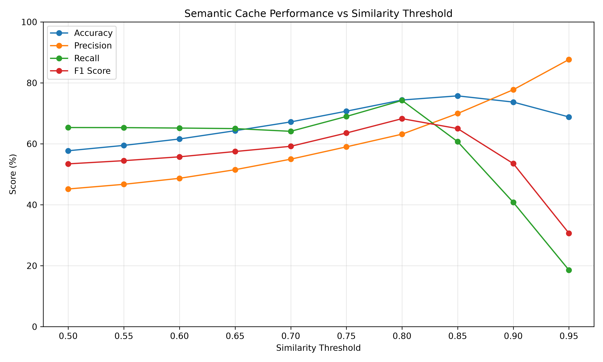
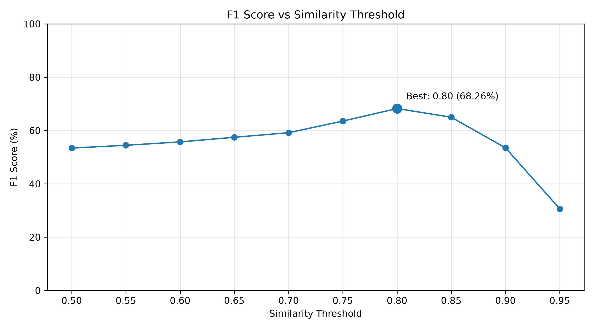
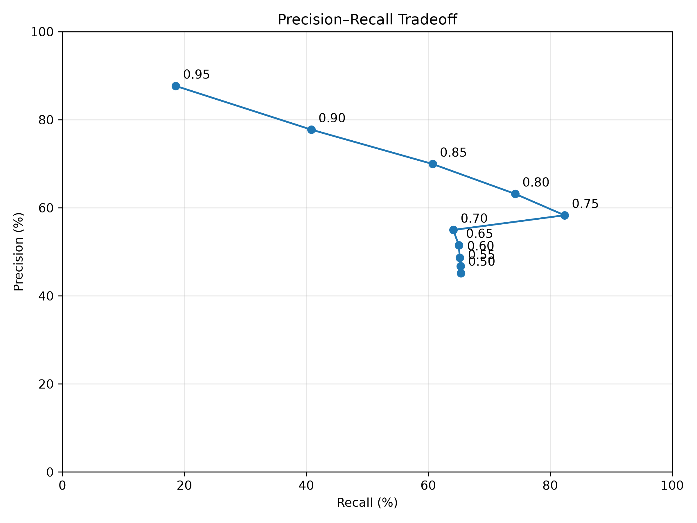
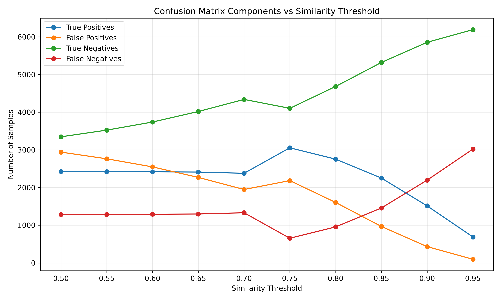

# Semantic Caching, PostgreSQL Persistence & PII Redaction Middleware

A high-performance, privacy-first **Semantic Caching, PostgreSQL Persistence (`pgvector`) & PII Redaction Middleware** designed for Large Language Model (LLM) applications.

This middleware combines **Redis HNSW Vector Similarity Search**, **PostgreSQL (`pgvector`) Long-Term Persistence & Pre-warming**, **Multiple Cache Invalidation & Eviction Strategies (TTL, Inactivity, Hit-Count, LRU, LFU, FIFO)**, **Unified Model Gateway Routing (LiteLLM)**, **Automated PII Redaction with Dynamic Rule Hot-Reloading (Microsoft Presidio)**, **Local LLM & Embedding Inference (Ollama)**, **OAuth2 JWT Authentication**, and a **Benchmarking & Threshold Optimization Suite**.

---

## Table of Contents

- [Overview](#-overview)
- [System Architecture](#-system-architecture)
- [Key Features](#-key-features)
- [Repository Structure](#-repository-structure)
- [Services & Docker Stack](#-services--docker-stack)
- [Configuration & Environment Variables](#-configuration--environment-variables)
- [Quick Start & Setup](#-quick-start--setup)
- [API Endpoints Reference](#-api-endpoints-reference)
- [Cache Invalidation & Eviction Strategies](#-cache-invalidation--eviction-strategies)
- [Custom PII Redaction Rules](#-custom-pii-redaction-rules)
- [Benchmarking & Threshold Evaluation](#-benchmarking--threshold-evaluation)
- [Testing](#-testing)
- [License](#-license)

---

## Overview

Querying Large Language Models directly for recurring or semantically equivalent prompts introduces unnecessary latency, high compute overhead, and privacy risks when user prompts contain sensitive Personally Identifiable Information (PII).

This middleware addresses these challenges through a unified multi-tiered architecture:

1. **PII Detection & Anonymization**: Scans incoming queries using Presidio Analyzer. If sensitive entities are detected, the cache is bypassed to avoid leaking confidential data, and redacted prompts are stored.
2. **Dynamic PII Rule Hot-Reloading**: Uploads YAML pattern recognizers on the fly without service interruptions or container restarts.
3. **High-Speed Semantic Search (Redis HNSW)**: Computes dense vector embeddings and queries Redis Stack using an HNSW index with Cosine distance metric.
4. **Multi-Strategy Invalidation & Capacity Eviction**: Periodically purges stale entries using configurable invalidation strategies (TTL, Inactivity, and Hit-Count thresholds) and enforces vector store capacity limits through pluggable eviction strategies (LRU, LFU, FIFO).
5. **Durable Persistence & Startup Pre-Warming (PostgreSQL `pgvector`)**: Stores cache entries, embeddings, and access analytics (`hit_count`, `last_hit_at`, `last_accessed_at`) in PostgreSQL 17, and pre-warms top-K hit entries into Redis during application startup.
6. **Unified Model Gateway (LiteLLM)**: Routes LLM inference and embeddings through a single proxy interface backed by Ollama or external providers.
7. **OAuth2 JWT Authentication**: Secures administrative actions (cache clearing and rule uploads) with token-based access control.

---

## System Architecture

```
                                  ┌─────────────────────────┐
                                  │      Client Request     │
                                  └────────────┬────────────┘
                                               │
                                               ▼
                                  ┌─────────────────────────┐
                                  │   FastAPI Web Server    │
                                  │ (JWT Auth & Lifespan)   │
                                  └────────────┬────────────┘
                                               │
                                    PII Check  ▼  (Presidio Analyzer)
                                  ┌─────────────────────────┐
                                  │     QueryProcessor      │
                                  └────────────┬────────────┘
                                               │
                           ┌───────────────────┴───────────────────┐
                           │                                       │
                 PII Found │                                       │ Clean Query
                           ▼                                       ▼
               ┌──────────────────────┐                ┌───────────────────────┐
               │  Direct LLM Request  │                │ LiteLLM Embedder      │
               │  (Cache Bypassed)    │                └───────────┬───────────┘
               └───────────┬──────────┘                            │
                           │                                       ▼
                           │                           ┌───────────────────────┐
                           │                           │ Redis HNSW Vector     │
                           │                           │ Search (FLOAT32)      │
                           │                           └───────┬───────┬───────┘
                           │                                   │       │
                           │                        Cache Hit  │       │ Cache Miss
                           │                                   ▼       ▼
                           │                           ┌──────────┐ ┌─────────────────────────┐
                           │                           │ Return   │ │ LiteLLM / Ollama        │
                           │                           │ Cached   │ │ LLM Service             │
                           │                           │ Response │ └────────────┬────────────┘
                           │                           └────┬─────┘              │
                           │                                │                    ▼
                           │                                │         ┌──────────────────────────┐
                           │                                │         │ Store in Redis Cache &   │
                           │                                │         │ Persist to PostgreSQL    │
                           │                                │         └──────────────────────────┘
                           ▼                                ▼
               ┌────────────────────────────────────────────────────────┐
               │         PostgreSQL Database (`pgvector`)               │
               │   - Persists clean / redacted entries & embeddings     │
               │   - Records hit_count & access timestamps              │
               │   - Pre-warms top-K hot entries into Redis on startup  │
               └────────────────────────────────────────────────────────┘
```

---

## Key Features

- **Asynchronous Semantic Caching**: Powered by Redis Stack using HNSW vector indexing (`FLOAT32`, Cosine distance metric) with namespace isolation.
- **Persistent Database Layer (`pgvector`)**: Stores cache entries in PostgreSQL 17 for durability across restarts, tracking hit counts and timestamps (`hit_count`, `last_hit_at`, `last_accessed_at`), with startup pre-warming of top-K entries.
- **Flexible Cache Invalidation & Eviction Strategies**: Includes built-in strategies running on asynchronous background loops:
  - **TTL Invalidation**: Evicts entries exceeding maximum time-to-live.
  - **Inactivity Invalidation**: Evicts entries inactive beyond a specified idle duration.
  - **Hit Count Invalidation**: Evicts entries with insufficient hit counts.
  - **Capacity-Based Eviction (LRU, LFU, FIFO)**: Automatically prunes excess entries when the cache exceeds capacity limits (`max_size`), supporting Least Recently Used (LRU), Least Frequently Used (LFU), and First-In First-Out (FIFO) policies.
- **Unified LiteLLM Gateway**: Proxies completions and embeddings across local models (Ollama) or external APIs via unified endpoints.
- **Sensitive PII Data Detection & Redaction**: Automatically identifies sensitive entities (`PERSON`, `EMAIL_ADDRESS`, `PHONE_NUMBER`, `CREDIT_CARD`, `IBAN_CODE`, `IP_ADDRESS`, `MEDICAL_LICENSE`, `EMPLOYEE_ID`, `CONFIDENTIAL_PROJECT`).
- **Dynamic Presidio Recognizer Reloading**: Uploads custom YAML regex recognizers with hot reload of the Presidio Analyzer without restarting containers.
- **OAuth2 JWT Authentication**: Protects administrative endpoints with bcrypt password hashing and JSON Web Tokens.
- **Local Inference with Ollama**: Pre-configured with local models (`qwen2.5:0.5b` for generation and `qwen3-embedding:0.6b` for 1024-dimensional embeddings).
- **Analytics & Cache Inspection**: Endpoints for inspecting Redis memory usage, vector counts, PostgreSQL top-K hit entries, and full cache dumps.
- **Integrated Developer GUIs**: Includes **RedisInsight** (Redis GUI) and **PgAdmin4** (PostgreSQL GUI) out of the box.
- **Benchmarking Suite & Threshold Tuning**: End-to-end evaluation suite on the Quora Question Pairs dataset with classification metrics and optimal similarity threshold analysis.

---

## Repository Structure

```
.
├── API/                          # FastAPI web application layer
│   ├── app.py                    # App factory & router registration
│   ├── lifespan.py               # Startup/shutdown lifecycle, DB pre-warming, invalidation & eviction loops
│   ├── auth/                     # JWT authentication & security utilities
│   │   └── security.py           # Password hashing, JWT token creation & admin dependencies
│   ├── routes/                   # Modular API routers
│   │   ├── auth.py               # Login endpoint (/auth/login)
│   │   ├── chat.py               # Chat endpoints (/chat/ttl_cache, /chat/inactivity_cache, /chat/hit_count_cache, /chat/fake_ask)
│   │   ├── delete.py             # Cache deletion endpoints (/delete/cache, /delete/fake_cache)
│   │   ├── get_all_hot_entries.py# Cache retrieval endpoint (/stats/get_all_entries)
│   │   ├── redaction_rules.py    # Custom PII rules upload (/rules/upload-redaction-rules)
│   │   ├── stats.py              # Redis cache statistics (/stats/stats)
│   │   └── top_k_entries.py      # PostgreSQL top-K entries (/stats/postgres_entries)
│   └── schemas/                  # Pydantic request and response schemas
│       └── query_request.py      # QueryRequest & NumberOfEntries models
├── benchmark/                    # Classification benchmarking & evaluation suite
│   ├── main.py                   # Main benchmark entrypoint script
│   ├── clients/                  # API test clients (AuthClient, CacheClient)
│   ├── datasets/                 # Evaluation dataset (Quora Question Pairs train.csv)
│   ├── metrics/                  # Classification metrics calculator (Accuracy, Precision, Recall, F1)
│   ├── quora_questions/          # Dataloader & schema for Quora Question Pairs
│   ├── runners/                  # Benchmark execution runner (SequentialBenchmarkRunner)
│   └── workers/                  # Worker execution engine
├── custom_recognizers/           # Custom Presidio YAML recognizer rules directory
├── litellm/                      # LiteLLM proxy configuration directory
├── ollama/                       # Local Ollama model manifests and weight storage
├── postgres/                     # PostgreSQL database initialization scripts
│   ├── init-cache-db.sh          # Multi-database & pgvector initialization script
│   └── schema.sql                # SQL schema definition for cache_entries table
├── semantic_caching/             # Core semantic caching & privacy engine
│   ├── semantic_caching.py       # Orchestration engine (pipeline workflow)
│   ├── query.py                  # Presidio Analyzer client & redaction processor
│   ├── cache_entry/              # Cache entry data models
│   │   ├── cache_entry.py        # Base CacheEntry abstract class
│   │   ├── cache_entry_persistent.py # PostgreSQL persistence entry model
│   │   └── cache_entry_retrieval.py  # Redis retrieval entry model
│   ├── cache_eviction/           # Capacity-based cache eviction strategies
│   │   ├── cache_eviction_strategy.py   # Abstract eviction strategy interface
│   │   ├── fifo_eviction_strategy.py    # First-In, First-Out (FIFO) eviction
│   │   ├── lfu_eviction_strategy.py     # Least Frequently Used (LFU) eviction
│   │   └── lru_eviction_strategy.py     # Least Recently Used (LRU) eviction
│   ├── cache_invalidation/       # Time & condition-based cache invalidation strategies
│   │   ├── cache_invalidation_strategy.py      # Abstract invalidation strategy interface
│   │   ├── ttl_invalidation_strategy.py         # Time-to-Live invalidation
│   │   ├── inactivity_invalidation_strategy.py  # Inactivity idle duration invalidation
│   │   └── hit_count_invalidation_strategy.py   # Hit-count threshold invalidation
│   ├── embedding_services/       # Embedding service implementations
│   │   ├── embedding_service.py  # Abstract Embedder interface
│   │   ├── litellm_embedding_service.py # LiteLLM embedding client
│   │   └── ollama_embedding.py   # Ollama direct embedding client
│   ├── llm_services/             # LLM service implementations
│   │   ├── llm_service.py        # Abstract LLM interface
│   │   ├── lite_llm_service.py   # LiteLLM client
│   │   ├── ollama_service.py     # Ollama direct LLM client
│   │   └── fake_llm_to_deploy.py # Mock LLM for high-speed benchmarking
│   ├── postgres_service/         # Asyncpg PostgreSQL pgvector service
│   │   └── postgres_service.py   # Connection pooling, persistence, and hit count updates
│   ├── presidio_analyzer/        # Custom Presidio Analyzer service with reload endpoint
│   │   ├── Dockerfile            # Analyzer container build file
│   │   ├── prisidio_reload_service.py # Dynamic reload HTTP trigger
│   │   └── server.py             # Presidio analyzer API server
│   └── vector_store_services/    # Vector store implementations
│       ├── vector_store_services.py  # Abstract VectorStore interface
│       ├── redis_service.py          # Redis Stack HNSW vector service
│       └── vector_search_result.py   # Search result data model
├── testing/                      # Test suite
│   ├── fake_components/          # Mock components for isolated unit testing
│   ├── unit_tests/               # Pytest unit tests for pipeline & thresholds
│   └── integration_testing/      # End-to-end integration tests with live services
├── threshold_tuning/             # Threshold evaluation results & visualizations
│   ├── results_1/                # Initial benchmark run results
│   └── results_2/                # Optimal benchmark evaluation results & charts
│       ├── final_results.json    # JSON results across thresholds (0.50 to 0.95)
│       ├── performance_vs_threshold.png
│       ├── f1_vs_threshold.png
│       ├── precision_recall_tradeoff.png
│       └── confusion_matrix_vs_threshold.png
├── utils/                        # Utility helpers
│   └── cosine_similarity.py      # Cosine similarity helper function
├── visualizations/               # Benchmark visualization scripts
│   ├── visualize_results.py      # Chart generation script
│   └── final_results.json        # Evaluated threshold benchmark results
├── config.py                     # Centralized settings with Pydantic BaseSettings
├── config.yaml                   # LiteLLM model routing definitions
├── Dockerfile                    # Container definition for FastAPI app
├── docker-compose.yml            # Multi-service stack definition
├── pytest.ini                    # Pytest configuration
├── requirements.txt              # Python project dependencies
└── test.py                       # Password hashing helper utility
```

---

## Services & Docker Stack

The multi-container stack defined in [`docker-compose.yml`](docker-compose.yml) includes 9 services:

| Service Container | Host Port | Internal Port | Description |
| :--- | :--- | :--- | :--- |
| `fastapi` | `8000` | `8000` | FastAPI Web Application & Semantic Caching Pipeline |
| `litellm` | `4000` | `4000` | LiteLLM Proxy Gateway for LLM completions and embeddings |
| `postgres` | *internal* | `5432` | PostgreSQL 17 with `pgvector` for cache persistence |
| `pgadmin` | `5050` | `80` | PgAdmin4 web GUI for PostgreSQL database inspection |
| `redis` | `6380` | `6379` | Redis Stack vector database with HNSW search index |
| `redisinsight` | `5540` | `5540` | RedisInsight web GUI for Redis cache inspection |
| `ollama` | `11434` | `11434` | Ollama local model inference server |
| `presidio-analyzer` | `5002` | `3000` | Presidio Analyzer with dynamic rule reloading API |
| `presidio-anonymizer` | `5001` | `3000` | Presidio Anonymizer microservice |

---

## Configuration & Environment Variables

Settings are defined in [`config.py`](config.py) and loaded from environment variables or a `.env` file:

| Variable | Default Value | Description |
| :--- | :--- | :--- |
| `REDIS_HOST` | `localhost` | Redis server hostname (set to `redis` in Docker) |
| `REDIS_PORT` | `6379` | Redis server port |
| `OLLAMA_HOST` | `http://localhost:11434` | Ollama endpoint URL (set to `http://ollama:11434` in Docker) |
| `ANALYZER_URL` | `http://localhost:5002/analyze` | Presidio Analyzer endpoint |
| `ANONYMIZER_URL` | `http://localhost:5001/anonymize` | Presidio Anonymizer endpoint |
| `CUSTOM_RULES_DIR` | `./custom_recognizers` | Directory containing custom Presidio YAML rules |
| `CACHE_POSTGRES_HOST` | `postgres` | PostgreSQL hostname |
| `CACHE_POSTGRES_PORT` | `5432` | PostgreSQL port |
| `CACHE_POSTGRES_DB` | *(Required)* | Persistent cache database name |
| `CACHE_POSTGRES_USER` | *(Required)* | PostgreSQL username |
| `CACHE_POSTGRES_PASSWORD` | *(Required)* | PostgreSQL password |
| `MODEL_NAME` | *(Configured)* | Model name configured in LiteLLM (e.g., `qwen`) |
| `API_KEY` | *(Configured)* | API Key for LiteLLM completion service |
| `EMBEDDING_MODEL_NAME` | *(Configured)* | Model name configured for embeddings (e.g., `qwen-embedding`) |
| `API_KEY_EMB` | *(Configured)* | API Key for LiteLLM embedding service |
| `EMBEDDING_MODEL_DIMENSION` | `1024` | Vector dimension size of embeddings |
| `CACHE_INVALIDATION_INTERVAL` | `30` | Interval (in seconds) between background invalidation cycles |
| `CACHE_EVICTION_INTERVAL` | `45` | Interval (in seconds) between background capacity eviction cycles |
| `CACHE_MAX_SIZE` | `100` | Maximum number of entries allowed in vector cache before capacity eviction triggers |
| `DELETE_ON_SHUTDOWN` | `true` | Wipes Redis vector cache upon application shutdown |
| `JWT_SECRET_KEY` | *(Required)* | Secret key for signing OAuth2 JWT tokens |
| `ADMIN_USERNAME` | *(Required)* | Admin username for protected routes |
| `ADMIN_PASSWORD_HASH` | *(Required)* | Bcrypt-hashed admin password |
| `ADMIN_PASSWORD` | *(Required)* | Plaintext admin password (used for authentication in tests/benchmarks) |
| `LITELLM_MASTER_KEY` | *(Required)* | LiteLLM master key |
| `UI_USERNAME` / `UI_PASSWORD` | *(Optional)* | LiteLLM dashboard UI credentials |

---

## Quick Start & Setup

### 1. Using Docker Compose (Recommended)

Start all 9 containers in detached mode:

```bash
docker-compose up --build -d
```

Access web services and dashboards:
- **FastAPI Documentation**: [http://localhost:8000/docs](http://localhost:8000/docs)
- **LiteLLM Gateway**: [http://localhost:4000](http://localhost:4000)
- **RedisInsight GUI**: [http://localhost:5540](http://localhost:5540)
- **PgAdmin4 GUI**: [http://localhost:5050](http://localhost:5050) (Default login: `demo@example.com` / `secret`)
- **Presidio Analyzer**: [http://localhost:5002/health](http://localhost:5002/health)

### 2. Manual Local Setup

1. **Create and activate a virtual environment**:
   ```bash
   python -m venv .venv
   source .venv/bin/activate
   ```

2. **Install dependencies**:
   ```bash
   pip install -r requirements.txt
   ```

3. **Configure Environment Variables**:
   Create a `.env` file in the root directory matching the settings in the table above.

4. **Launch the FastAPI application**:
   ```bash
   uvicorn API.app:app --host 0.0.0.0 --port 8000 --reload
   ```

---

## API Endpoints Reference

### 1. Authentication

#### Admin Login (`POST /auth/login`)
Authenticates an administrator and generates a JWT Bearer token.
- **Request Body** (`application/x-www-form-urlencoded`):
  - `username`: `<ADMIN_USERNAME>`
  - `password`: `<ADMIN_PASSWORD>`
- **Response**:
  ```json
  {
    "access_token": "eyJhbGciOiJIUzI1NiIsInR5cCI6IkpXVCJ9...",
    "token_type": "bearer"
  }
  ```

---

### 2. Semantic Caching & Chat Endpoints

#### Ask with TTL Invalidation & LRU Eviction (`POST /chat/ttl_cache`)
Queries the semantic cache instance configured with a **Time-To-Live (TTL)** invalidation strategy (default: 60 seconds) and **Least Recently Used (LRU)** capacity eviction (`max_size=100`).
- **Request Body**:
  ```json
  {
    "query": "What is semantic caching?"
  }
  ```
- **Response (Cache Miss)**:
  ```json
  {
    "cache_hit": false,
    "cosine_distance": null,
    "answer": "Semantic caching is an optimization technique that stores and retrieves responses based on vector similarity...",
    "time": "2026-08-24T08:00:00.000000+00:00"
  }
  ```
- **Response (Cache Hit)**:
  ```json
  {
    "cache_hit": true,
    "cosine_distance": 0.8842,
    "answer": "Semantic caching is an optimization technique that stores and retrieves responses based on vector similarity...",
    "time": "2026-08-24T08:00:00.000000+00:00",
    "id": "lite_ttl:550e8400-e29b-41d4-a716-446655440000"
  }
  ```
- **Response (PII Detected - Cache Bypassed)**:
  ```json
  {
    "cache_hit": false,
    "cache_bypassed": true,
    "answer": "Hello John Doe, your request has been processed securely."
  }
  ```

#### Ask with Inactivity Invalidation & LFU Eviction (`POST /chat/inactivity_cache`)
Queries the cache instance configured with an **Inactivity** invalidation strategy (invalidates entries after 60 seconds of idle time without access) and **Least Frequently Used (LFU)** capacity eviction (`max_size=100`).

#### Ask with Hit Count Invalidation & FIFO Eviction (`POST /chat/hit_count_cache`)
Queries the cache instance configured with a **Hit Count** invalidation strategy (invalidates entries with fewer than 5 hits) and **First-In First-Out (FIFO)** capacity eviction (`max_size=100`).

#### Fast Ask for Benchmarking (`POST /chat/fake_ask`)
Queries a high-speed mock LLM cache instance (`threshold=0.95`) designed for evaluation pipelines and throughput benchmarks.

---

### 3. Cache Statistics & Inspection

#### Redis Cache Stats (`GET /stats/stats`)
Returns memory usage and key count from the vector store.
- **Response**:
  ```json
  {
    "Total keys": 42,
    "Memory used (bytes)": 1542000
  }
  ```

#### PostgreSQL Top-K Entries (`POST /stats/postgres_entries`)
Fetches the top `k` most frequently matched cache entries recorded in PostgreSQL.
- **Request Body**:
  ```json
  {
    "k": 5
  }
  ```
- **Response**:
  ```json
  {
    "entries": [
      {
        "question": "What is machine learning?",
        "hit_count": 14,
        "embedding_dimension": 1024
      }
    ]
  }
  ```

#### Retrieve All Cache Entries (`GET /stats/get_all_entries`)
Returns all active entries with metadata from the vector store.
- **Response**:
  ```json
  {
    "count": 1,
    "entries": [
      {
        "id": "550e8400-e29b-41d4-a716-446655440000",
        "question": "What is semantic caching?",
        "answer": "Semantic caching stores responses based on meaning...",
        "namespace": "ttl",
        "created_at": "2026-08-24T08:00:00+00:00",
        "ttl_seconds": 60,
        "hit_count": 3,
        "last_hit_at": "2026-08-24T08:05:00+00:00",
        "last_accessed_at": "2026-08-24T08:05:00+00:00",
        "embedding_dimension": 1024
      }
    ]
  }
  ```

---

### 4. Cache Deletion & Rules Management (Protected)

#### Clear Vector Cache (`DELETE /delete/cache`)
- **Headers**: `Authorization: Bearer <JWT_TOKEN>`
- **Response**:
  ```json
  {
    "message": "Cache deleted successfully."
  }
  ```

#### Clear Fake Test Cache (`DELETE /delete/fake_cache`)
- **Headers**: `Authorization: Bearer <JWT_TOKEN>`
- **Response**:
  ```json
  {
    "message": "Fake Cache deleted successfully."
  }
  ```

#### Upload Custom Redaction Rules (`POST /rules/upload-redaction-rules`)
Uploads a custom YAML recognizer rule file and triggers an immediate hot reload of Presidio Analyzer.
- **Body** (`multipart/form-data`): `file: <rules.yaml>`
- **Response**:
  ```json
  {
    "status": "uploaded",
    "filename": "custom_rules.yaml"
  }
  ```

---

## Cache Invalidation & Eviction Strategies

The middleware implements the **Strategy Pattern** across two complementary memory and lifecycle management layers:

1. **Cache Invalidation (Time & Condition-Based)**: Proactively purges individual stale, inactive, or low-utility entries during periodic sweeps regardless of total cache size.
2. **Cache Eviction (Capacity & Size-Based)**: Enforces memory boundaries when the number of cached entries exceeds `max_size` (e.g., 100 entries), algorithmically pruning excess entries based on access recency, frequency, or insertion order.

```
                  ┌─────────────────────────────────────────────────────────┐
                  │                 Semantic Caching Layer                  │
                  └────────────┬───────────────────────────────┬────────────┘
                               │                               │
                Periodic Check │ (Every 30s)    Periodic Check │ (Every 45s if size > max_size)
                               ▼                               ▼
                 ┌───────────────────────────┐   ┌───────────────────────────┐
                 │ Cache Invalidation Engine │   │   Cache Eviction Engine   │
                 └─────────────┬─────────────┘   └─────────────┬─────────────┘
                               │                               │
            ┌──────────────────┼──────────────────┐            ├──────────────────┬──────────────────┐
            ▼                  ▼                  ▼            ▼                  ▼                  ▼
     ┌──────────────┐   ┌──────────────┐   ┌──────────────┐ ┌──────────────┐   ┌──────────────┐   ┌──────────────┐
     │     TTL      │   │  Inactivity  │   │  Hit-Count   │ │     LRU      │   │     LFU      │   │     FIFO     │
     │ Invalidation │   │ Invalidation │   │ Invalidation │ │   Eviction   │   │   Eviction   │   │   Eviction   │
     └──────────────┘   └──────────────┘   └──────────────┘ └──────────────┘   └──────────────┘   └──────────────┘
```

---

### 1. Cache Invalidation Strategies

Invalidation strategies evaluate each cache entry independently during background sweeps to discard entries that have expired or failed utility criteria:

- **`TTLInvalidationStrategy` (Time-To-Live)**:
  - **Rule**: Invalidate if `(now - created_at) > ttl_seconds`.
  - **Default Configuration**: `ttl_seconds = 60` seconds.
  - **Use Case**: Real-time or rapidly changing data (news, stock prices, live weather) where responses expire after a fixed lifespan.
- **`InactivityInvalidationStrategy`**:
  - **Rule**: Invalidate if `(now - (last_accessed_at or created_at)) > inactivity_seconds`.
  - **Default Configuration**: `inactivity_seconds = 60` seconds.
  - **Use Case**: Session-based dialogs and interactive multi-turn workflows where conversations naturally expire once idle.
- **`HitCountInvalidationStrategy`**:
  - **Rule**: Invalidate if `hit_count < min_hit_count`.
  - **Default Configuration**: `min_hit_count = 5` hits.
  - **Use Case**: Periodic garbage collection of rare one-off queries to reserve vector memory for high-yield prompts.

> **Background Lifecycle**: Controlled by `invalidation_loop(cache, interval_seconds=settings.cache_invalidation_interval)` running every **30 seconds** asynchronously.

---

### 2. Cache Eviction Strategies

Eviction strategies manage vector database capacity. When `current_size > max_size`, the strategy calculates `number_to_evict = current_size - max_size` and ranks entries to prune:

- **`LRUEvictionStrategy` (Least Recently Used)**:
  - **Algorithm**: Sorts entries by effective last access time (`entry.last_accessed_at if entry.last_accessed_at is not None else entry.created_at`) ascending and selects the oldest `k` entries.
  - **Assigned Route**: Paired with `ttl_cache` (`POST /chat/ttl_cache`).
  - **Use Case**: General-purpose conversational caching where recently referenced topics are significantly more likely to be queried again (temporal locality).
- **`LFUEvictionStrategy` (Least Frequently Used)**:
  - **Algorithm**: Sorts entries by total `entry.hit_count` ascending and selects the lowest-frequency `k` entries.
  - **Assigned Route**: Paired with `inactivity_cache` (`POST /chat/inactivity_cache`).
  - **Use Case**: Workloads with heavy power-law query distributions (e.g., FAQ knowledge bases), keeping popular questions resident even during temporary lulls in traffic.
- **`FIFOEvictionStrategy` (First-In, First-Out)**:
  - **Algorithm**: Sorts entries strictly by creation timestamp (`entry.created_at`) ascending and selects the oldest inserted `k` entries.
  - **Assigned Route**: Paired with `hit_count_cache` (`POST /chat/hit_count_cache`).
  - **Use Case**: Streaming logs, time-series data feeds, or sequential pipelines where entries have uniform longevity.

> **Background Lifecycle**: Controlled by `eviction_loop(cache, interval_seconds=settings.cache_eviction_interval, max_size=settings.cache_max_size)` running every **45 seconds** with `max_size=100`.

---

### 3. Strategy Summary & Comparison Matrix

| Strategy Name | Category | Primary Metric | Trigger Condition | Default Endpoint | Best For |
| :--- | :--- | :--- | :--- | :--- | :--- |
| **`TTLInvalidationStrategy`** | Invalidation | `created_at` age | `elapsed > ttl_seconds` | `/chat/ttl_cache` | Time-sensitive, volatile data |
| **`InactivityInvalidationStrategy`** | Invalidation | `last_accessed_at` age | `idle > inactivity_seconds` | `/chat/inactivity_cache` | Interactive sessions & active topics |
| **`HitCountInvalidationStrategy`** | Invalidation | `hit_count` | `hit_count < min_hit_count` | `/chat/hit_count_cache` | Pruning cold, one-off prompts |
| **`LRUEvictionStrategy`** | Eviction | Recency (`last_accessed_at`) | `cache_size > max_size` | `/chat/ttl_cache` | Temporal locality & conversational caching |
| **`LFUEvictionStrategy`** | Eviction | Frequency (`hit_count`) | `cache_size > max_size` | `/chat/inactivity_cache` | Highly skewed FAQ & popular query distributions |
| **`FIFOEvictionStrategy`** | Eviction | Age (`created_at`) | `cache_size > max_size` | `/chat/hit_count_cache` | Rolling queue & streaming pipelines |

---

## Custom PII Redaction Rules

Custom regex recognizers can be saved in `custom_recognizers/` or uploaded via `POST /rules/upload-redaction-rules`.

Example YAML rule structure:

```yaml
recognizers:
  - name: "EmployeeIDRecognizer"
    supported_language: "en"
    supported_entity: "EMPLOYEE_ID"
    patterns:
      - name: "emp_id_pattern"
        regex: "\\bEMP-\\d{5}\\b"
        score: 0.95
  - name: "ProjectCodeRecognizer"
    supported_language: "en"
    supported_entity: "CONFIDENTIAL_PROJECT"
    patterns:
      - name: "project_code_pattern"
        regex: "\\bPROJECT-[A-Z]{3}-\\d{3}\\b"
        score: 0.90
```

Uploading a rule automatically triggers the `/reload` endpoint on the Presidio Analyzer container, registering the new recognizers immediately.

---

## Benchmarking & Threshold Evaluation

### Running the Benchmark

Run the automated classification benchmarking framework on the Quora Question Pairs dataset:

```bash
python -m benchmark.main
```

The runner logs in using OAuth2 JWT credentials, processes question pairs sequentially through the pipeline, and evaluates duplicate detection performance.

### Similarity Threshold Optimization Results

Evaluating similarity thresholds across cosine distance metrics determines the optimal balance between cache hit rate and semantic accuracy. The benchmark evaluated 10 threshold levels (from `0.50` to `0.95` with step `0.05`) on 10,000 question pairs.

#### Threshold Evaluation Summary Table

| Similarity Threshold | Accuracy (%) | Precision (%) | Recall (%) | F1 Score (%) | True Positives (TP) | False Positives (FP) | True Negatives (TN) | False Negatives (FN) |
| :---: | :---: | :---: | :---: | :---: | :---: | :---: | :---: | :---: |
| 0.50 | 57.73% | 45.19% | 65.35% | 53.43% | 2,425 | 2,941 | 3,348 | 1,286 |
| 0.55 | 59.49% | 46.72% | 65.32% | 54.48% | 2,424 | 2,764 | 3,525 | 1,287 |
| 0.60 | 61.59% | 48.69% | 65.18% | 55.74% | 2,419 | 2,549 | 3,740 | 1,292 |
| 0.65 | 64.31% | 51.52% | 65.00% | 57.48% | 2,412 | 2,270 | 4,019 | 1,299 |
| 0.70 | 67.19% | 54.97% | 64.11% | 59.19% | 2,379 | 1,949 | 4,340 | 1,332 |
| **0.75** | **71.60%** | **58.31%** | **82.35%** | **68.28%** | **3,056** | **2,185** | **4,104** | **655** |
| **0.80** | **74.38%** | **63.17%** | **74.24%** | **68.26%** | **2,755** | **1,606** | **4,683** | **956** |
| **0.85** | **75.74%** | **69.95%** | **60.71%** | **65.00%** | **2,253** | **968** | **5,321** | **1,458** |
| 0.90 | 73.70% | 77.76% | 40.80% | 53.52% | 1,514 | 433 | 5,856 | 2,197 |
| 0.95 | 68.82% | 87.67% | 18.59% | 30.68% | 690 | 97 | 6,192 | 3,021 |

#### Key Analytical Takeaways:
- **Peak F1 Score (Threshold 0.75 - 0.80)**: Threshold **0.75** achieves the highest F1 score (**68.28%**) with strong recall (**82.35%**), while threshold **0.80** provides an almost identical F1 score (**68.26%**) with significantly improved accuracy (**74.38%**) and precision (**63.17%**).
- **Maximum Accuracy (Threshold 0.85)**: Threshold **0.85** achieves peak overall classification accuracy (**75.74%**) with precision rising to **69.95%**.
- **High-Precision / Low-Risk Mode (Threshold 0.90 - 0.95)**: Threshold **0.95** reaches **87.67% precision** with only 97 false positives across the entire dataset, making it ideal for zero-tolerance or mission-critical enterprise caching.

---

### Threshold Evaluation Visualizations

The following charts illustrate the performance dynamics across similarity thresholds:

#### 1. Performance Metrics vs. Similarity Threshold
Tracks **Accuracy**, **Precision**, **Recall**, and **F1 Score** across similarity threshold levels from 0.50 to 0.95:



#### 2. F1 Score Optimization Curve
Highlights the peak F1 Score balance achieved at threshold **0.75** (68.28%):



#### 3. Precision–Recall Tradeoff
Visualizes the relationship and operating points between precision and recall across similarity thresholds:



#### 4. Confusion Matrix Breakdown vs. Threshold
Shows the distribution of **True Positives (TP)**, **False Positives (FP)**, **True Negatives (TN)**, and **False Negatives (FN)** per threshold value:



To regenerate these visualization charts locally, run:
```bash
python visualizations/visualize_results.py
```

---

## Testing

### Running Unit Tests
Execute unit tests with mock LLM, embedder, and vector store components:

```bash
pytest testing/unit_tests/
```

### Running Integration Tests
Execute end-to-end integration tests against live Docker services (Ollama, Redis Stack, and PostgreSQL):

```bash
pytest testing/integration_testing/
```

---

## License

This project is licensed under the MIT License.
